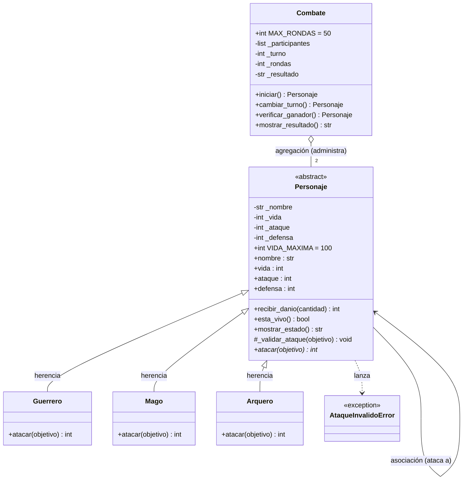

# Guardians of the Ancient Kingdom

Sistema de combate por turnos en Python, desarrollado como proyecto integrador de **Programación Orientada a Objetos**.

---

## 1. Descripción

En el reino de Eldoria existen tres órdenes de guardianes: **Guerreros**, **Magos** y **Arqueros**. Todos comparten nombre, vida, ataque y defensa, pero cada orden ataca de forma distinta.

El programa resuelve el problema de **enfrentar a dos guardianes y decidir automáticamente quién gana**. Para ello calcula el daño según la habilidad de cada personaje, controla los turnos, actualiza la vida (sin permitir valores imposibles como una vida negativa) y termina el combate cuando hay un vencedor o un empate.

## 2. Estructura

```text
Guardians-of-the-Ancient-Kingdom/
├── personajes.py        # Definición de las clases (no ejecuta nada al importarse)
├── main.py              # Creación de objetos, combates y casos de prueba
├── test_personajes.py   # Pruebas automatizadas con Pytest (Reto 2)
└── README.md            # Esta documentación
```

| Archivo | Contenido |
|---|---|
| `personajes.py` | `Personaje` (abstracta), `Guerrero`, `Mago`, `Arquero`, `Combate` y la excepción `AtaqueInvalidoError`. Contiene constructores, atributos encapsulados, getters/setters, validaciones y lógica. |
| `main.py` | Importa las clases, crea personajes, ejecuta ataques y combates y muestra los 12 casos de prueba obligatorios (más dos casos extra). No repite ninguna implementación. |
| `test_personajes.py` | 34 pruebas automatizadas que verifican las reglas del sistema. |

## 3. Clases y responsabilidades

- **`Personaje` (abstracta):** guarda y valida lo que todos los guardianes tienen en común (nombre, vida, ataque, defensa), sabe recibir daño, informar si sigue vivo y mostrar su estado. Declara `atacar()` como abstracto porque no sabe *cómo* atacará cada tipo.
- **`Guerrero`:** implementa *Golpe poderoso*: `max(0, ataque × 1.20 − defensa)`, redondeando hacia abajo.
- **`Mago`:** implementa *Hechizo penetrante*: el daño es su ataque, ignorando la defensa.
- **`Arquero`:** implementa *Disparo crítico*: si `ataque > defensa`, el daño es `(ataque − defensa) × 2`; si no, es 0.
- **`Combate`:** no es un personaje; es quien **dirige** la pelea. Alterna turnos, llama a `atacar()`, muestra el estado tras cada ataque, detecta al ganador y decide los empates.

## 4. Relaciones entre clases

| Relación | Dónde está | Por qué se usó |
|---|---|---|
| **Herencia** ("es un") | `Guerrero`, `Mago` y `Arquero` heredan de `Personaje` | Un Guerrero *es un* Personaje. Se evita repetir atributos y validaciones en tres clases. |
| **Asociación** ("usa a") | `atacante.atacar(objetivo)` | Dos personajes colaboran: uno llama a un método del otro (`recibir_danio`). Ninguno es dueño del otro. |
| **Agregación** ("tiene") | `Combate` recibe dos personajes ya creados | Un combate *tiene* participantes, pero estos existen antes y después de él. `Combate` los administra, no los crea. |

### Diagrama de clases UML (Reto 1)



**Cómo leerlo:**
- `<<abstract>>` y el `*` junto a `atacar()` marcan la clase y el método abstractos.
- La flecha con triángulo vacío (`<|--`) es **herencia**: las tres subclases implementan `atacar()`.
- La flecha simple (`-->`) de `Personaje` hacia `Personaje` es la **asociación**: un personaje interactúa con otro al atacar.
- El rombo vacío (`o--`) es la **agregación**: `Combate` agrupa a dos personajes que existen por su cuenta.
- `-` indica atributo privado (encapsulado), `+` público y `#` de uso interno.

GitHub renderiza este diagrama automáticamente al abrir el README.

## 5. Conceptos de POO aplicados

- **Abstracción:** `Personaje` define *qué* debe poder hacer un guardián (`atacar`) sin decir *cómo*. Es una clase abstracta (`ABC`) con `@abstractmethod`, así que no se puede instanciar directamente (el caso 1 de `main.py` lo comprueba).
- **Encapsulamiento:** los atributos son privados (`_vida`, `_ataque`...) y se acceden con `@property` y setters que validan. Por eso es imposible crear una vida de 150 o un nombre vacío, y `recibir_danio()` nunca deja la vida bajo cero.
- **Herencia:** `Guerrero`, `Mago` y `Arquero` reutilizan el constructor, las validaciones, `recibir_danio()`, `esta_vivo()` y `mostrar_estado()` de `Personaje`. Cada una solo escribe lo que la distingue: su `atacar()`.
- **Polimorfismo:** en `Combate.iniciar()` aparece `atacante.atacar(objetivo)`. La misma línea produce daño distinto según el objeto que sea (26, 30 o 40 con el mismo ataque de 30 contra defensa 10, en el caso extra de `main.py`) y `Combate` **nunca pregunta** si es Guerrero, Mago o Arquero.

## 6. Lógica del combate

**Cálculo del daño** (siempre entero y nunca negativo):

| Clase | Fórmula |
|---|---|
| Guerrero | `max(0, ataque × 1.20 − defensa)`; se calcula con enteros (`ataque * 120 // 100`) para redondear hacia abajo sin errores de decimales |
| Mago | `ataque` |
| Arquero | `(ataque − defensa) × 2` si `ataque > defensa`; si no, `0` |

El daño ya llega calculado a `recibir_danio()`, que **no vuelve a restar la defensa**; solo descuenta la vida con tope en 0 y devuelve el daño *efectivo* (por ejemplo, 20 si el objetivo tenía 20 de vida y el golpe era de 40).

**Validaciones comunes de ataque:** el objetivo debe ser un `Personaje`, no puede ser el mismo atacante, y ni el atacante ni el objetivo pueden estar derrotados (`AtaqueInvalidoError`).

**Turnos:**
1. El primer personaje recibido ataca primero; `cambiar_turno()` alterna entre los dos.
2. Tras cada ataque se imprime el estado de ambos.
3. Si uno llega a 0 de vida, `verificar_ganador()` devuelve al otro y el combate termina (el derrotado no vuelve a atacar).
4. Una **ronda** se completa cuando ambos atacaron. Si en una ronda completa nadie recibió daño → **empate técnico**.
5. Si se completan **50 rondas** sin ganador → **empate**.

## 7. Ejecución

Requisitos: Python 3.8 o superior.

```bash
git clone https://github.com/JulianDavidJ/Guardians-of-the-Ancient-Kingdom.git
cd Guardians-of-the-Ancient-Kingdom
python main.py
```

(En algunos sistemas el comando es `python3 main.py`.) No requiere instalar nada para el programa principal; solo las pruebas automatizadas necesitan Pytest.

## 8. Pruebas

Ejecutando `python main.py` se muestran los 12 casos obligatorios, todos con resultado **OK**:

| # | Caso | Resultado |
|---|---|---|
| 1 | Creación de Guerrero, Mago y Arquero | Correcto; `Personaje` no se puede instanciar |
| 2 | Vida > 100 o negativa | Rechazada con `ValueError` |
| 3 | Nombre vacío | Rechazado con `ValueError` |
| 4 | Ataque ≤ 0 y defensa negativa | Rechazados |
| 5 | Guerrero (ataque 30 vs defensa 10) | Daño 26 |
| 6 | Mago (ataque 40 vs defensa 20) | Daño 40 |
| 7 | Arquero (ataque 35 vs defensa 15) | Daño 40; sin crítico si no supera la defensa |
| 8 | Vida 20 recibe 50 de daño | Vida 0, daño efectivo 20 |
| 9 | Derrotado intenta atacar | `AtaqueInvalidoError` |
| 10 | Combate completo Arthas vs Gandalf | 6 turnos, coincide con el ejemplo del enunciado |
| 11 | Ganador | **Gandalf** (2 de vida; Arthas en 0) |
| 12 | Arqueros sin daño mutuo | Empate técnico en la ronda 1 |

Además, un caso extra comprueba el empate por 50 rondas y otro muestra el polimorfismo. Resumen final del programa: `41 de 41 comprobaciones correctas`.

### Pruebas automatizadas con Pytest (Reto 2)

**Pytest** es una librería de Python para escribir pruebas automáticas: cada función `test_...` ejecuta código del programa y usa `assert` (o `pytest.raises` para errores esperados) para comprobar el resultado. Así las reglas se verifican de forma repetible, sin revisar mensajes a ojo. `@pytest.mark.parametrize` permite probar varios valores con una sola función.

```bash
pip install pytest
pytest -v
```

Las pruebas (`test_personajes.py`) cubren: creación válida, rechazo de valores incorrectos, daño de cada clase (incluido el redondeo del Guerrero), vida nunca negativa, derrotado que no puede atacar y resultado de los combates (victoria, empate técnico y empate por 50 rondas).

**Resultado de la ejecución:**

```text
<!-- PEGA AQUÍ LA SALIDA REAL DE `pytest -v` EJECUTADO EN TU COMPUTADOR -->
```

## Reto de abstracción

**¿Por qué `atacar()` es abstracto, pero `recibir_danio()` puede estar implementado en `Personaje`?**

La diferencia está en qué parte del comportamiento **cambia** entre personajes y cuál **no**.

**`atacar()` cambia según el tipo.** Cuando `Personaje` se diseña no puede saber cómo se ataca, porque un "personaje en general" no ataca de ninguna forma concreta. El Guerrero potencia su ataque un 20 % y resta defensa; el Mago ignora la defensa; el Arquero duplica el daño solo si supera la defensa. Con los mismos datos (ataque 30 contra defensa 10) los resultados son 26, 30 y 40. Cualquier implementación en la clase base sería arbitraria y estaría mal para al menos dos de las tres clases. Declararlo abstracto cumple dos funciones: **obliga** a cada subclase a implementar su versión (si olvido hacerlo, Python no deja crear el objeto) y **garantiza** que todo `Personaje` tenga un `atacar()`, que es lo que necesita `Combate`.

**`recibir_danio()` es igual para todos.** Una vez calculado el daño, lo que le pasa al receptor no depende de su orden: se rechaza una cantidad negativa, se descuenta de la vida, la vida no baja de cero y se devuelve el daño efectivo. Un Mago con 20 de vida que recibe 50 queda en 0, igual que un Guerrero o un Arquero. Como la regla es idéntica, escribirla una sola vez en `Personaje` evita repetirla tres veces y evita que una copia tenga un error que las otras no. Además, la defensa ya se aplicó en `atacar()`, así que `recibir_danio()` no necesita saber nada del tipo.

**Relación con los pilares de la POO:**
- **Abstracción:** `Personaje` expone el contrato ("todo guardián puede atacar") sin detallar el cómo.
- **Herencia:** las subclases reutilizan `recibir_danio()`, `esta_vivo()` y las validaciones, y solo aportan lo propio.
- **Polimorfismo:** como todos cumplen el contrato, `Combate` llama a `atacante.atacar(objetivo)` sin conocer la clase concreta; cada objeto responde a su manera. Por eso se podría añadir un nuevo guardián (por ejemplo un `Paladin`) escribiendo solo su `atacar()` y **sin modificar** `Combate`.

En resumen: lo que varía se declara abstracto y se implementa en cada subclase; lo que se mantiene igual se implementa una vez en la clase base.
